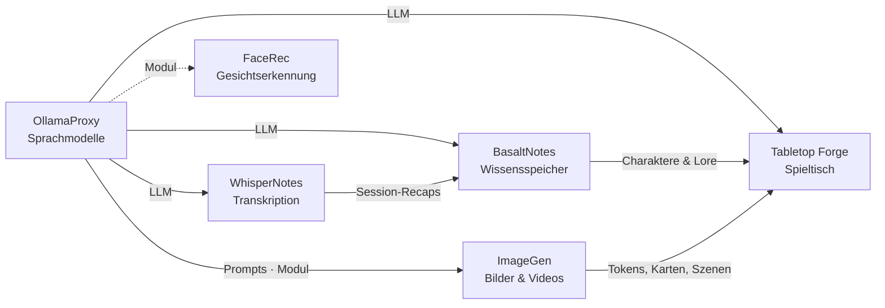

# OllamaProxy

🇬🇧 [English](README.md) · 🇩🇪 Deutsch

> Normalisierender Proxy vor Ollama: feste Einstellungen je Modell, kein ständiges Neuladen – die KI-Zentrale der
> Poldion-Familie.

**Lizenz:** MIT · **Sprache:** Python (FastAPI) · **Läuft auf:** Linux (AMD-GPU, ROCm/Vulkan) und macOS ·
**Teil von:** [Poldion Self-Hosted](#die-poldion-familie)


## Überblick

Jeder Client (Open WebUI, Home Assistant, Agenten, eigene Apps) schickt eigene Einstellungen an Ollama – vor allem
`num_ctx`. Ollama lädt das Modell dann jedes Mal neu. Der Proxy sitzt dazwischen, gibt nur ausgewählte Modelle frei
und erzwingt für jedes genau eine Konfiguration. So bleibt pro Modell ein einziger Runner dauerhaft im Speicher.
Alle Clients zeigen einfach auf den Proxy statt auf Ollama.

Andere Dienste auf derselben Maschine – etwa [ImageGen](https://github.com/Poldion/ImageGen) (ComfyUI mit Web-App)
oder [FaceRec](https://github.com/Poldion/FaceRec) (Gesichtserkennung für die Türklingel) – lassen sich als
[Module](#module) einklinken: Sie erscheinen mit Link und Speicherverbrauch in der Oberfläche, und der Proxy gibt
ihren Speicher frei, wenn ein Sprachmodell Platz braucht.

## Funktionen

| Bereich | Was es kann |
|---|---|
| **Freigegebene Modelle** | Liste von Modellen mit Alias, `num_ctx`, `keep_alive`, think-Vorgabe und „vorladen“; unbekannte Namen gehen an das Standardmodell |
| **Profile** | Weitere Modellnamen mit eigenen Sampling-Werten auf demselben Runner (z. B. `Qwen3.6-Code`) – ohne Neuladen |
| **OpenAI → nativ** | Übersetzt `/v1/chat/completions` und `/v1/completions` in Ollamas native API (inkl. Streaming, Werkzeugaufrufen, Bildern, `reasoning_effort`), damit Kontext und `keep_alive` auch für OpenAI-Clients gelten |
| **Gefilterte Discovery** | `/api/tags`, `/v1/models` und `/api/ps` melden nur freigegebene Modelle, Standardmodell zuerst |
| **Bild-/Audio-Helfer** | Modelle ohne Vision oder Audio bekommen Bilder und Audio vorab von einem Helfermodell beschrieben bzw. transkribiert |
| **Wächter** | Lädt dauerhafte Modelle nach einem Neustart oder Fremd-Reload automatisch nach – nur wenn sie laut Prognose in den Speicher passen |
| **Speicheranzeige** | Echter Verbrauch je Modell (macOS: Prozessmessung + IOAccelerator, Linux: RSS + amdgpu-GTT/VRAM) und je Modul |
| **Module** | Weitere Dienste mit Link, Speicher und „Freigeben“; der Wächter gibt sie nach Leerlauf frei |
| **Schleifen-Bremse** | Entfernt neutrale Strafwerte (`presence_penalty 0` …), damit die Werte aus dem Modelfile gelten |
| **Antwortlänge je Client** | Optional begrenzt, z. B. kurze Sprachantworten für Home Assistant |
| **Presets & Web-UI** | Modelle ziehen, löschen, laden, entladen; komplette Modelllisten als Presets speichern. Oberfläche auf Deutsch und Englisch |

## Schnellstart

**Docker (Linux mit AMD-GPU)** – Ollama und Proxy als ein Stack:

```bash
git clone https://github.com/Poldion/OllamaProxy.git ~/ollama-proxy/app
cp ~/ollama-proxy/app/deploy/stack.env.example ~/ollama-proxy/stack.env   # anpassen
cd ~/ollama-proxy/app && docker compose --env-file ../stack.env up -d --build
```

**Ohne Docker** (vorhandenes Ollama auf Port 11434):

```bash
python3 -m venv venv && venv/bin/pip install -r requirements.txt
OLLAMA_UPSTREAM=http://localhost:11434 venv/bin/python ollama_proxy.py
```

Danach `http://<host>:11435/` öffnen, Modelle freigeben und „Anwenden“ klicken. Clients bekommen
`http://<host>:11435` (Ollama) bzw. `http://<host>:11435/v1` (OpenAI-kompatibel).

## Konfiguration

| Variable | Standard | Bedeutung |
|---|---|---|
| `OLLAMA_UPSTREAM` | `http://localhost:11434` | Adresse von Ollama |
| `PROXY_HOST` / `PROXY_PORT` | `0.0.0.0` / `11435` | Worauf der Proxy lauscht |
| `PROXY_STATE` | `./proxy_state.json` | Gespeicherte Modellliste und Presets |
| `PROXY_MODULES_FILE` | `modules.json` neben dem State | Liste der Module |
| `PROXY_KEEP_LOADED_INTERVAL` | `60` | Sekunden zwischen zwei Prüfungen des Wächters (`0` = aus) |
| `PROXY_MAX_PREDICT` | `0` | Höchstlänge einer Antwort in Token (`0` = unbegrenzt) |
| `PROXY_MAX_PREDICT_CLIENTS` | – | Grenze je Client-IP, z. B. `192.168.1.10=1024` |
| `OLLAMA_KV_CACHE_TYPE` | `f16` | Nur für Anzeige und Prognose; muss zum Wert des Ollama-Servers passen |

Endpunkte: native Ollama-API (`/api/*`), OpenAI-kompatibel (`/v1/*`), Steuerung unter `/admin/*`.
Die Steuerung hat keine Anmeldung – den Proxy nur im eigenen Netz betreiben.

## Module

Ein Modul ist ein Dienst mit einer kleinen HTTP-Schnittstelle. Eingetragen wird es in `modules.json`
(Vorlage [deploy/modules.json.example](deploy/modules.json.example)):

```json
{"modules": [
  {"name": "ImageGen", "url": "http://host.docker.internal:8190", "idle_free_minutes": 2},
  {"name": "FaceRec", "url": "http://host.docker.internal:8191"}
]}
```

| Feld | Bedeutung |
|---|---|
| `url` | Adresse, unter der der Proxy das Modul erreicht (aus dem Container: `host.docker.internal`) |
| `name` | optional, sonst der Name aus der Selbstauskunft |
| `public_url` | optional: Basis für Links, wenn das Modul im Browser anders erreichbar ist |
| `idle_free_minutes` | Freigabe nach so vielen Minuten Leerlauf (überschreibt den Vorschlag des Moduls, `0` = nie) |
| `token` | optional: wird als `Authorization: Bearer …` mitgeschickt |

Das Modul bietet an:

| Endpunkt | Antwort |
|---|---|
| `GET /proxy-module` | `{name, version, links: [{label, path \| port \| url}], capabilities: ["memory", "free"], idle_free_minutes}` |
| `GET /proxy-module/memory` | `{rss, gpu, held, reclaimable, busy, detail}` in Bytes (Fähigkeit `memory`) |
| `POST /proxy-module/free` | Speicher freigeben, Status 200 bei Erfolg (Fähigkeit `free`) |

`held` zählt in der Anzeige zu „davon Modelle“, `gpu` wird vom GPU-Anteil der Sprachmodelle abgezogen. Module mit
`free`, die `reclaimable` und nicht `busy` melden, gibt der Wächter nach `idle_free_minutes` frei. Links mit `path`
zeigen auf den Port aus `url` (bzw. auf `public_url`), Links mit `port` auf denselben Rechner wie die Proxy-Oberfläche.
Der Proxy schickt `Accept-Language` mit der Sprache seiner Oberfläche (`de` oder `en`), damit Module `label` und
`detail` passend liefern können.

Frühere Einstellungen per Umgebung (`COMFYUI_URL`, `WEBAPP_PUBLIC_PORT`, `FACEREC_PUBLIC_PORT`,
`COMFYUI_IDLE_FREE_MINUTES`) werden ohne `modules.json` automatisch in Module übersetzt.

## Zusammenspiel mit der Poldion-Familie

- **[WhisperNotes](https://github.com/Poldion/WhisperNotes)** und **[BasaltNotes](https://github.com/Poldion/BasaltNotes)**
  nutzen den Proxy für Zusammenfassungen, den KI-Kurator und den Chat. Sie lesen die erzwungene Kontextgröße aus
  `/admin/state` und passen ihre Eingaben daran an.
- **[ImageGen](https://github.com/Poldion/ImageGen)** formuliert kurze Bildideen über den Proxy zu ausführlichen Prompts
  aus und meldet sich als Modul an (Speicher, Links, Freigabe nach Leerlauf).
- **[FaceRec](https://github.com/Poldion/FaceRec)** erscheint als Modul mit Link zur Oberfläche und Speicherverbrauch.
- **[Tabletop Forge](https://github.com/Poldion/TabletopForge)** spricht den Proxy als OpenAI-kompatibles Sprachmodell an.

## Die Poldion-Familie

Sechs selbst gehostete Projekte, die einzeln funktionieren und zusammen ein Ganzes ergeben:



| Projekt | Rolle |
|---|---|
| **OllamaProxy** (dieses Repository) | KI-Zentrale: Sprachmodelle mit festen Einstellungen, Module für weitere Dienste |
| [ImageGen](https://github.com/Poldion/ImageGen) | Bilder und Videos mit ComfyUI, Web-App und API |
| [FaceRec](https://github.com/Poldion/FaceRec) | Gesichtserkennung an der Türklingel für Home Assistant |
| [WhisperNotes](https://github.com/Poldion/WhisperNotes) | Transkription, Sprechererkennung, Zusammenfassungen und D&D-Recaps |
| [BasaltNotes](https://github.com/Poldion/BasaltNotes) | Notizen und Welt-Wiki mit KI-Kurator |
| [Tabletop Forge](https://github.com/Poldion/TabletopForge) | Digitaler Spieltisch und Kampagnenverwaltung für 5e |

## Dokumentation

- [docs/linux-amd.md](docs/linux-amd.md) – Betrieb unter Linux mit AMD-GPU: Docker oder systemd, GTT-Einstellung, ROCm oder Vulkan, Speichermessung (Englisch: [linux-amd.en.md](docs/linux-amd.en.md))
- [docs/macos.md](docs/macos.md) – Betrieb unter macOS mit launchd und typische Stolpersteine (Englisch: [macos.en.md](docs/macos.en.md))
- [CHANGELOG.md](CHANGELOG.md) – Versionsverlauf (nur Englisch)
- [CONTRIBUTING.md](CONTRIBUTING.md) – Entwicklungsumgebung, Tests, Regeln (nur Englisch, mit deutschem Abschnitt)
- [SECURITY.md](SECURITY.md) – Sicherheitslücken melden (nur Englisch)

## Entwicklung

```bash
./run_tests.sh                    # Tests in Docker (Ollama und ein Modul werden nachgebaut)
python -m pytest tests            # oder direkt: pip install -r requirements.txt pytest
scripts/deploy.sh --target <name> # committen, pushen, auf dem Ziel aktualisieren
```

`scripts/update.sh` läuft auf dem Zielrechner: holt den neuen Stand, prüft ihn, startet den Dienst neu (launchd, systemd
oder Docker) und rollt bei einem Fehler zurück. `scripts/check-host.sh` prüft einen Linux-Host vorab. Ziele stehen in
`deploy/targets.local.env` (Vorlage: [deploy/targets.env.example](deploy/targets.env.example)).

## Lizenz & Drittanbieter

Der Code steht unter der [MIT-Lizenz](LICENSE). Modelle werden nicht mitgeliefert; Sprachmodelle haben eigene Lizenzen
(z. B. Gemma Terms of Use, Apache-2.0), die du beim Laden einhalten musst. Verwendete Software mit ihren Lizenzen:
[THIRD_PARTY_NOTICES.md](THIRD_PARTY_NOTICES.md).

## Unterstützen

Wenn dir das Projekt hilft, freue ich mich über Rückmeldungen, Fehlerberichte und Pull Requests – siehe
[CONTRIBUTING.md](CONTRIBUTING.md).
Ein Spenden-Link folgt. <!-- SPENDEN_LINK -->
