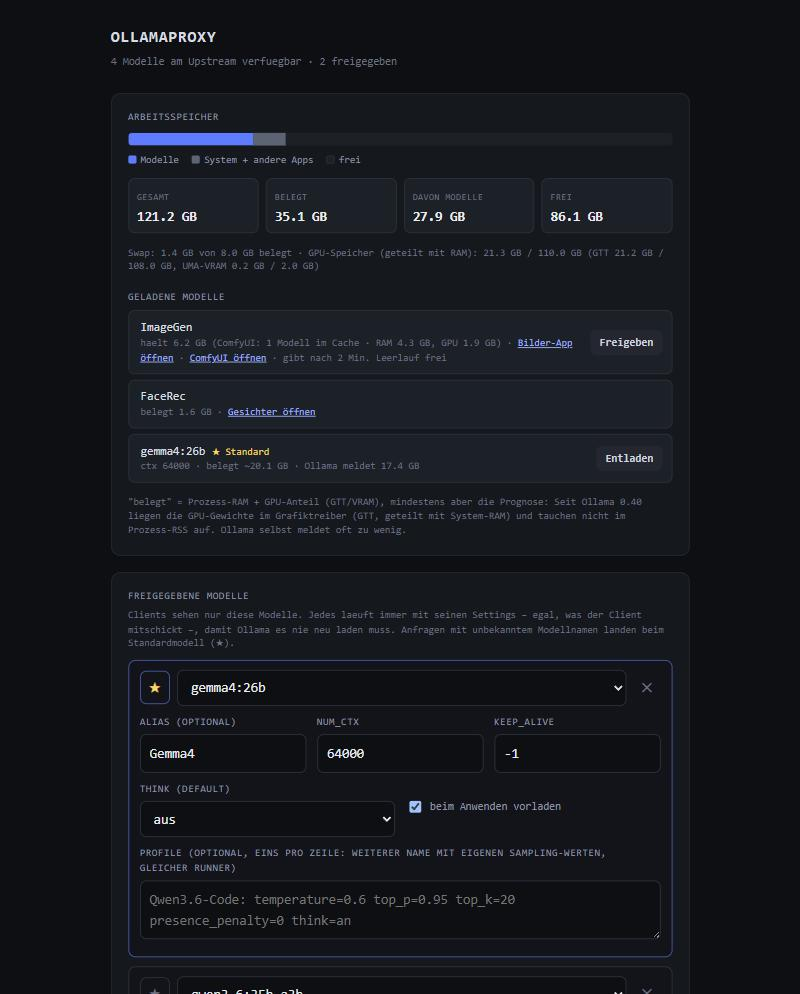
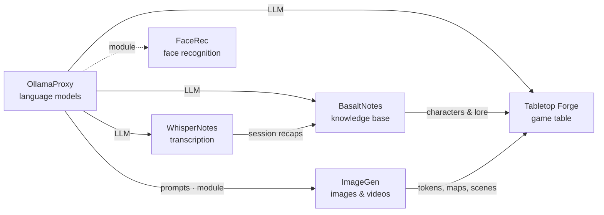

# OllamaProxy

🇬🇧 English · 🇩🇪 [Deutsch](README.de.md)

> Normalizing proxy in front of Ollama: fixed settings per model, no constant reloading – the AI hub of the Poldion
> family.

**License:** MIT · **Language:** Python (FastAPI) · **Runs on:** Linux (AMD GPU, ROCm/Vulkan) and macOS ·
**Part of:** [Poldion Self-Hosted](#the-poldion-family)



## Overview

Every client (Open WebUI, Home Assistant, agents, your own apps) sends its own settings to Ollama – above all
`num_ctx`. Ollama then reloads the model again and again. The proxy sits in between, exposes only selected models and
enforces exactly one configuration for each. That keeps a single runner per model in memory. All clients simply point
to the proxy instead of Ollama.

Other services on the same machine – for example [ImageGen](https://github.com/Poldion/ImageGen) (ComfyUI with a web
app) or [FaceRec](https://github.com/Poldion/FaceRec) (face recognition for the doorbell) – can plug in as
[modules](#modules): they show up with a link and their memory use in the UI, and the proxy frees their memory when a
language model needs the space.

## Features

| Area | What it does |
|---|---|
| **Released models** | List of models with alias, `num_ctx`, `keep_alive`, think default and "preload"; unknown names go to the default model |
| **Profiles** | Additional model names with their own sampling values on the same runner (e.g. `Qwen3.6-Code`) – no reload |
| **OpenAI → native** | Translates `/v1/chat/completions` and `/v1/completions` into Ollama's native API (incl. streaming, tool calls, images, `reasoning_effort`), so context and `keep_alive` apply to OpenAI clients too |
| **Filtered discovery** | `/api/tags`, `/v1/models` and `/api/ps` only report released models, default model first |
| **Image/audio helper** | Models without vision or audio get images described and audio transcribed by a helper model first |
| **Watchdog** | Reloads permanent models after a restart or a foreign reload – only if they fit into memory according to the estimate |
| **Memory view** | Real usage per model (macOS: process measurement + IOAccelerator, Linux: RSS + amdgpu GTT/VRAM) and per module |
| **Modules** | Other services with link, memory and "free"; the watchdog frees them after idle time |
| **Loop brake** | Drops neutral penalty values (`presence_penalty 0` …) so the values from the Modelfile apply |
| **Answer length per client** | Optional limit, e.g. short voice answers for Home Assistant |
| **Presets & web UI** | Pull, delete, load and unload models; save complete model lists as presets. UI in German |

## Quick start

**Docker (Linux with AMD GPU)** – Ollama and proxy as one stack:

```bash
git clone https://github.com/Poldion/OllamaProxy.git ~/ollama-proxy/app
cp ~/ollama-proxy/app/deploy/stack.env.example ~/ollama-proxy/stack.env   # adjust
cd ~/ollama-proxy/app && docker compose --env-file ../stack.env up -d --build
```

**Without Docker** (existing Ollama on port 11434):

```bash
python3 -m venv venv && venv/bin/pip install -r requirements.txt
OLLAMA_UPSTREAM=http://localhost:11434 venv/bin/python ollama_proxy.py
```

Then open `http://<host>:11435/`, release models and click "Anwenden" (apply). Clients use `http://<host>:11435`
(Ollama) or `http://<host>:11435/v1` (OpenAI-compatible).

## Configuration

| Variable | Default | Meaning |
|---|---|---|
| `OLLAMA_UPSTREAM` | `http://localhost:11434` | Address of Ollama |
| `PROXY_HOST` / `PROXY_PORT` | `0.0.0.0` / `11435` | Where the proxy listens |
| `PROXY_STATE` | `./proxy_state.json` | Saved model list and presets |
| `PROXY_MODULES_FILE` | `modules.json` next to the state | List of modules |
| `PROXY_KEEP_LOADED_INTERVAL` | `60` | Seconds between two watchdog checks (`0` = off) |
| `PROXY_MAX_PREDICT` | `0` | Maximum answer length in tokens (`0` = unlimited) |
| `PROXY_MAX_PREDICT_CLIENTS` | – | Limit per client IP, e.g. `192.168.1.10=1024` |
| `OLLAMA_KV_CACHE_TYPE` | `f16` | Only for display and estimate; must match the Ollama server |

Endpoints: native Ollama API (`/api/*`), OpenAI-compatible (`/v1/*`), control under `/admin/*`.
The control endpoints have no login – run the proxy in your own network only.

## Modules

A module is a service with a small HTTP interface. It is registered in `modules.json`
(template [deploy/modules.json.example](deploy/modules.json.example)):

```json
{"modules": [
  {"name": "ImageGen", "url": "http://host.docker.internal:8190", "idle_free_minutes": 2},
  {"name": "FaceRec", "url": "http://host.docker.internal:8191"}
]}
```

| Field | Meaning |
|---|---|
| `url` | Address where the proxy reaches the module (from the container: `host.docker.internal`) |
| `name` | optional, otherwise the name the module reports |
| `public_url` | optional: base for links if the module is reached differently from the browser |
| `idle_free_minutes` | Free after this many idle minutes (overrides the module's suggestion, `0` = never) |
| `token` | optional: sent as `Authorization: Bearer …` |

The module provides:

| Endpoint | Response |
|---|---|
| `GET /proxy-module` | `{name, version, links: [{label, path \| port \| url}], capabilities: ["memory", "free"], idle_free_minutes}` |
| `GET /proxy-module/memory` | `{rss, gpu, held, reclaimable, busy, detail}` in bytes (capability `memory`) |
| `POST /proxy-module/free` | Free memory, status 200 on success (capability `free`) |

`held` counts towards "models" in the memory view, `gpu` is subtracted from the GPU share of the language models.
Modules with `free` that report `reclaimable` and not `busy` are freed by the watchdog after `idle_free_minutes`.
Links with `path` point to the port from `url` (or to `public_url`), links with `port` to the same host as the proxy UI.

Older environment settings (`COMFYUI_URL`, `WEBAPP_PUBLIC_PORT`, `FACEREC_PUBLIC_PORT`, `COMFYUI_IDLE_FREE_MINUTES`)
are translated into modules automatically when there is no `modules.json`.

## Working with the Poldion family

- **[WhisperNotes](https://github.com/Poldion/WhisperNotes)** and **[BasaltNotes](https://github.com/Poldion/BasaltNotes)**
  use the proxy for summaries, the AI curator and chat. They read the enforced context size from `/admin/state` and
  size their input accordingly.
- **[ImageGen](https://github.com/Poldion/ImageGen)** expands short image ideas into detailed prompts through the proxy
  and registers as a module (memory, links, freeing after idle time).
- **[FaceRec](https://github.com/Poldion/FaceRec)** shows up as a module with a link to its UI and its memory use.
- **[Tabletop Forge](https://github.com/Poldion/TabletopForge)** talks to the proxy as an OpenAI-compatible language model.

## The Poldion family

Six self-hosted projects that work on their own and form a whole together:



| Project | Role |
|---|---|
| **OllamaProxy** (this repository) | AI hub: language models with fixed settings, modules for other services |
| [ImageGen](https://github.com/Poldion/ImageGen) | Images and videos with ComfyUI, web app and API |
| [FaceRec](https://github.com/Poldion/FaceRec) | Face recognition at the doorbell for Home Assistant |
| [WhisperNotes](https://github.com/Poldion/WhisperNotes) | Transcription, speaker detection, summaries and D&D recaps |
| [BasaltNotes](https://github.com/Poldion/BasaltNotes) | Notes and world wiki with an AI curator |
| [Tabletop Forge](https://github.com/Poldion/TabletopForge) | Digital game table and campaign management for 5e |

## Documentation

- [docs/linux-amd.md](docs/linux-amd.md) – running on Linux with an AMD GPU: Docker or systemd, GTT setting, ROCm or Vulkan, memory measurement (German)
- [docs/macos.md](docs/macos.md) – running on macOS with launchd and common pitfalls (German)
- [CHANGELOG.md](CHANGELOG.md) – version history
- [CONTRIBUTING.md](CONTRIBUTING.md) – development setup, tests, guidelines
- [SECURITY.md](SECURITY.md) – reporting security issues

## Development

```bash
./run_tests.sh                    # tests in Docker (Ollama and a module are simulated)
python -m pytest tests            # or directly: pip install -r requirements.txt pytest
scripts/deploy.sh --target <name> # commit, push, update the target
```

`scripts/update.sh` runs on the target machine: fetches the new version, checks it, restarts the service (launchd,
systemd or Docker) and rolls back on failure. `scripts/check-host.sh` checks a Linux host beforehand. Targets live in
`deploy/targets.local.env` (template: [deploy/targets.env.example](deploy/targets.env.example)).

## License & third parties

The code is licensed under the [MIT License](LICENSE). No models are included; language models have their own licenses
(e.g. Gemma Terms of Use, Apache-2.0) that you must follow when you download them. Software used and its licenses:
[THIRD_PARTY_NOTICES.md](THIRD_PARTY_NOTICES.md).

## Support

If the project helps you, I'm happy about feedback, bug reports and pull requests – see [CONTRIBUTING.md](CONTRIBUTING.md).
A donation link will follow. <!-- SPENDEN_LINK -->
